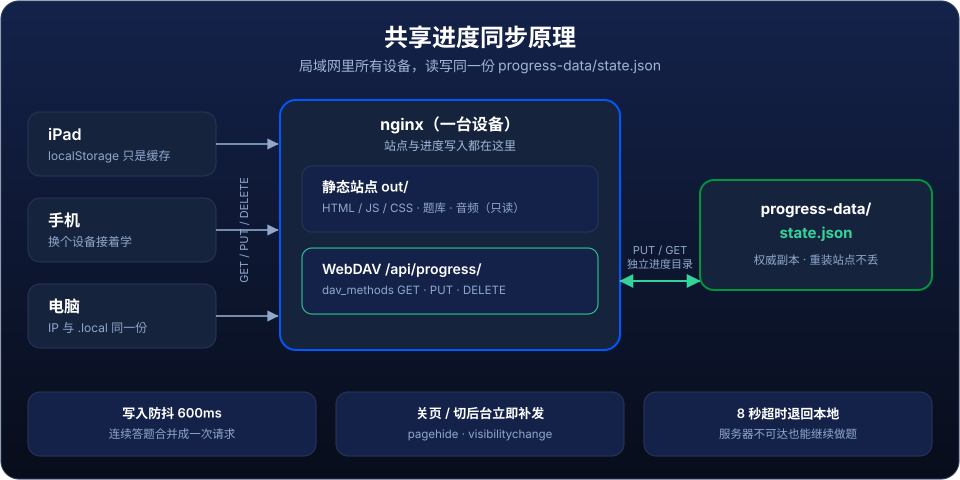

<h1 align="center">CSF-Nginx</h1>

<h3 align="center">把「聪聪学堂」搬进自家路由器 / NAS / 小盒子<br>全屋设备共用一份学习进度，装完即用、离线断网也能继续学</h3>

<p align="center">
<a href="https://github.com/marspang/CSF-Nginx/releases"></a>
<a href="https://github.com/wuwangzhang1216/ChinaTextbookStudyFree"></a>


</p>

[聪聪学堂](https://github.com/wuwangzhang1216/ChinaTextbookStudyFree)（ChinaStudyFree）是一个**免费、开源、纯公益**的小学全科学习平台，覆盖语文 / 数学 / 英语 / 科学。<br>涵盖一到六年级，纯静态导出、不用 Node 运行时，能跑 nginx 的设备就能自托管。

## 目录

- [支持的设备与实测情况](#支持的设备与实测情况) · [装之前先看空间](#装之前先看空间全量要留多少)
- [它长什么样](#它长什么样)
- [快速开始](#快速开始) · [常用参数](#常用参数)
- [用一段提示词，让你的 Agent 自动安装](#用一段提示词让你的-agent-自动安装)
- [目录结构](#目录结构)
- [共享进度是怎么实现的](#共享进度是怎么实现的)
- [上游内容规模](#上游内容规模来自聪聪学堂)
- [常见问题 FAQ](#常见问题-faq)
- [致谢与许可](#致谢与许可)

上游路线图里有两项长期未打的勾：

> - [ ] 云端学习记录与跨设备同步
> - [ ] 离线版 / 校园内网部署包

**这个仓库就是来补这两件事的**：

1. **一键部署** —— 按平台分好的安装脚本，自动搞定 nginx、站点产物、静态资源、开机自启；
2. **跨设备共享进度** —— nginx 用 WebDAV 暴露一个 `state.json`，iPad 上学到 20%，换手机 / 电脑接着学，而不是从 0 重新开始；
3. **平台适配** —— 明确区分 Docker 路线（iStoreOS / NAS）与原生 nginx 路线（Debian / WanOS），已知差异和坑都写进 [docs/PLATFORMS.md](docs/PLATFORMS.md)。

整站跑在你自己的局域网里：**不依赖外网、不上报数据、断网也能继续做题**。一个 2.1GB 的资源包 + 一个约 14MB 站点产物，装完即用。

---

## 支持的设备与实测情况

| 平台 | 部署路线 | 安装脚本 | 实测状态 |
| --- | --- | --- | --- |
| &nbsp; **iStoreOS / OpenWrt（带 Docker）** | Docker（`nginx:alpine`） | `install/istoreos-openwrt/install.sh` | ✅ **实机跑通**（站点 200 / 进度 PUT+GET 一致 / 资源包解包正常），按「装完即删」清理干净 |
| &nbsp; **飞牛 fnOS（NAS）** | Docker（`nginx:alpine`） | `install/nas-docker/install.sh` | ✅ **长期运行中**（端口 8899） |
| &nbsp; **玩客云 WanOS（Ubuntu 20.04 armhf）** | 原生（apt + systemd） | `install/wanos/install.sh` | ✅ **长期运行中**，已做断电重启端到端验证 |
| &nbsp; **Debian / Ubuntu** | 原生（apt + systemd） | `install/debian/install.sh` | ✅ 在 Ubuntu 20.04（玩客云）验证；Debian 同构可用 |
| &nbsp; **Armbian 26.11 / Debian 13（aarch64）** | 原生（apt + systemd） | `install/debian/install.sh` | ✅ **已实机跑通**（站点 200 / 图标 200 / 共享进度 PUT 201 + 回读一致 / 音频 200），脚本自带 `nginx -t` 与开机自启 |
| &nbsp; 群晖 DSM / Unraid / 威联通 / TrueNAS | Docker（`nginx:alpine`） | `install/nas-docker/install.sh` | ⚪ 同构方案，未逐台验证 |

<p align="center">
  <picture>
    <source media="(prefers-color-scheme: dark)" srcset="assets/icons/nginx-dark.svg">
    
  </picture>
  <br>
  各类平台最终都跑在 <b>nginx</b> 之上。<br>
  共享进度由 nginx 的内置 WebDAV 模块提供，<b>不需要任何后端服务或数据库</b>。
</p>

- **架构无要求**：aarch64（iStoreOS / 飞牛 / Armbian）、armhf（玩客云）、x86_64 均已实测或同构可用。
- **纯 OpenWrt（不带 Docker）不支持**：官方 feed 的 nginx 是裁剪版、**不带 `--with-http_dav_module`**，静态页面能开但共享进度没有。能装 Docker 就走 Docker 路线。原因见 [docs/PLATFORMS.md](docs/PLATFORMS.md)。

### 装之前先看空间：全量要留多少

| 装法 | 需要下载 | 装完占盘 | 建议预留可用空间 |
| --- | --- | --- | --- |
| 默认（站点 + 精简资源，44 册配套） | 2.1GB | 2.1GB | **4GB 起** |
| 按年级裁剪（只装某几个年级） | 复用已下好的包 | 见下表，每个年级 0.5~1.1GB | 该年级体积 + 1~2GB 余量 |
| **`--upstream` 上游全量**（45 本书 / 约 2700 课时 / 1.5 万题 / 11.9 万条 MP3） | **9.1GB** | **9.5GB** | **16GB 起** |

全量为什么建议 16GB：装完 9.5GB 之外，安装时还要同时放下最大约 1.4GB 的临时压缩包和文件系统余量，峰值接近 11GB；小容量卡写满会直接失败，留足才不会装到一半卡死。

**按年级装，每个年级要多少**

| 年级 | 册数 | 页面 + 题库 | 教材扫描页 | 绘本插图 | 音频 MP3 | 该年级合计 | 装到该年级累计 |
| --- | --- | --- | --- | --- | --- | --- | --- |
| 一年级 | 6 | 22MB | 22MB | 64MB | 358MB | **0.5GB** | 0.5GB |
| 二年级 | 7 | 25MB | 25MB | 68MB | 468MB | **0.6GB** | 1.1GB |
| 三年级 | 8 | 40MB | 35MB | 108MB | 769MB | **1.0GB** | 2.0GB |
| 四年级 | 8 | 46MB | 41MB | 101MB | 829MB | **1.0GB** | 3.0GB |
| 五年级 | 8 | 44MB | 44MB | 111MB | 882MB | **1.1GB** | 4.1GB |
| 六年级 | 8 | 44MB | 43MB | 98MB | 856MB | **1.0GB** | 5.1GB |

六册合计 5.1GB（外加共用前端约 20MB）。以上是只保留 MP3 的口径；如果同时保留 `audio-web` 的 Opus 备用格式，音频部分要再翻一倍，全量 9.5GB 就是这么来的。

**空间不够就插 SD 卡 / U 盘**（玩客云 8G eMMC、Armbian 6.5G 卡这类设备实测只剩 2~4GB，装不下全量）：

```bash
sudo mkdir -p /mnt/sd && sudo mount /dev/mmcblk1p1 /mnt/sd   # 确认卡的实际设备名
sudo bash install/debian/install.sh --upstream --root /mnt/sd/csf

# 别忘了写进 /etc/fstab，否则重启后挂载点空了，站点直接 404
echo '/dev/mmcblk1p1 /mnt/sd ext4 defaults,noatime 0 2' | sudo tee -a /etc/fstab
```

Docker 路线同样可以外挂：把 `--root` 指到 SD 卡的挂载点即可（`-v` 的宿主目录就是它）。

其它省空间的办法：

- **先只要页面和题库**：`--upstream --upstream-only web,data`，约 250MB，音频以后再补
- **按年级装**：按上表挑需要的年级，装一两个年级通常 1GB 内就能放下
- 音频是全量里的大头（8.6GB，其中 MP3 4.2GB / Opus 4.5GB）——不要 Opus 就能省掉近一半

安装脚本会自己核对空间，不够时直接退出并提示改用 `--root` 换分区，不会写一半留个坏站点。

---

## 它长什么样

部署完，局域网里任意设备打开 `http://<设备IP>:8899/` 就能开始学：

- iPad 做题做到一半 → 手机打开，进度、错题本、连续天数都是接着的
- 同一台设备换地址访问（IP 和 `xxx.local` 混用），进度也是同一份
- 服务器上存的是**权威副本**，设备本地 localStorage 只当缓存；断网时照样能继续做题（不白屏）

---

## 快速开始

先克隆（脚本之间会互相调用，建议整仓库克隆而不是单文件下载）：

```bash
git clone https://github.com/marspang/CSF-Nginx.git
cd CSF-Nginx
```

然后按你的设备选一条：

```bash
# iStoreOS / OpenWrt（带 Docker）
sudo bash install/istoreos-openwrt/install.sh

# 飞牛 fnOS / 群晖 / Unraid / 威联通 / 任何有 Docker 的 NAS
sudo bash install/nas-docker/install.sh

# Debian / Ubuntu（apt 系，原生 nginx）
sudo bash install/debian/install.sh

# 玩客云刷 WanOS（本质是 Ubuntu 20.04 armhf）
sudo bash install/wanos/install.sh

# 想直接装上游官方全量内容（45 本书 / 全部音频，约 9.5GB）就在命令后加 --upstream
sudo bash install/debian/install.sh --upstream
```

脚本会自动完成：装 nginx → 下站点产物 → 下静态资源 → 写 nginx 配置 → 设置进度目录权限 → 起服务并自启 → **自检**（`/`、`/icon.svg` 看状态码，再对 `/api/progress/` 做一次真实的 `PUT → GET → DELETE` 往返，确认共享进度真的可写可读）。

装完会打印访问地址。卸载：

```bash
sudo bash install/<平台>/install.sh --uninstall --root <安装目录>
```

### 常用参数

| 参数 | 说明 |
| --- | --- |
| `--port 8899` | 换监听端口（默认 8899，刻意避开路由器的 80/443） |
| `--root /mnt/sda1/csf` | 指定落盘目录（OpenWrt 的 overlay 通常很小，数据要放别的大分区） |
| `--no-assets` | 先不下 2.1GB 的音频 / 课本页 / 绘本图，只把站点跑起来 |
| `--assets-src /mnt/nas/csf-assets` | 从本地 / NAS 上已有的副本装资源（盒子直连 GitHub 很慢时用这个） |
| `--force` | 强制重新下载站点产物 |
| `--upstream` | 全量安装上游官方发布包（45 本书、约 2700 课时、11.9 万条 MP3，约 9.5GB） |
| `--upstream-src /mnt/nas/csf-upstream` | 上游包已在别处下好时，直接从这里取（不再联网） |
| `--upstream-only web,data` | 只装某几类内容，例如先跑页面与题库，音频以后再补 |

> 站点产物只有 **~14MB**（Release 资产 `csf-core.tar.gz`，带 SHA256 校验）；
> 音频 / 课本扫描页 / 绘本插图合计 **~2.1GB**，由上游项目以 Release 资产（`v1.2.0-assets`）发布，
> 由 `scripts/fetch-assets.sh` 负责拉取与落位。

### 全量装上游发布包（`--upstream`）

不想只用 44 册的精简内容，而是把上游 `v1.4.3-content-restored` 的**全部东西**装到设备上，加 `--upstream`：

```bash
sudo bash install/debian/install.sh --upstream
# 网络慢：先在 NAS 上用同一脚本把包下好，其余设备再指向它
bash scripts/fetch-upstream.sh --site-dir /mnt/nas/csf-upstream --only web,data    # 示例
sudo bash install/debian/install.sh --upstream --upstream-src /mnt/nas/csf-upstream
```

`scripts/fetch-upstream.sh` 会按官方 `manifest.json` 逐包 **SHA256 校验**后解压，落盘布局与上游一致：
页面与 JS、题库与课程数据、100% 全量音频（MP3 + Opus）、教材扫描页、绘本插图。
装完会自检两件事：`index.html` / `data/index.json` 是否齐备，以及**数据里引用的每一条音频是否都在盘上**（缺一条就报错退出）。

关于公式：上游这份包是**构建期渲染好的成品**，KaTeX 只经过一次反转义，不会出现 `a.bimesc` 这类把 `\times` 吃成英文字母的页面；
本仓库自己构建源码时，`MathText` 组件里的 `healEscapedLatex` 也会兜住同样的问题。两条路径装上后公式都是 `×` `÷`。

---

## 用一段提示词，让你的 Agent 自动安装

不想敲命令也行——把下面这段提示词**整段复制**，发给你本机 / 工作台上的 AI Agent（Codex、WorkBuddy、豆包工作、Trae、Cursor……任何能读写文件并执行命令的 Agent），它会自己读仓库、认设备、挑对应脚本给你装好。

```text
请帮我把「聪聪学堂」自托管站点部署到这台设备上：
https://github.com/marspang/CSF-Nginx

先读仓库的 README 和 docs/PLATFORMS.md，再根据 install/ 下的脚本判断这台设备走哪条路线：
带 Docker 的 iStoreOS / OpenWrt、飞牛 fnOS / 群晖等 NAS、Debian / Ubuntu，
还是玩客云这类刷了 WanOS 的小盒子；挑对应的 install.sh 执行安装，
最后用 curl 自检站点首页，并对 /api/progress/ 做一次 PUT → GET → DELETE 往返。

动手前先跟我确认下面几项，缺哪项就问我，不要自己猜：
1) 设备 IP 和 SSH 端口（你也可以先扫一遍局域网把它找出来）；
2) SSH 登录方式：root 还是 sudo 用户，用密码还是密钥；
3) 是否已有本地的 2.1GB 资源副本（盒子直连 GitHub 很慢，有的话用 --assets-src 指过去）。

过程中缺依赖（docker / nginx / git / curl / tar）就说明缺什么并帮我装上。
凡是需要我在设备上确认、授权或输密码的，告诉我明确步骤，等我做完再继续。
装完把访问地址、自检结果和 --uninstall 卸载命令一起告诉我。
```

> ⚠️ **注意事项**
>
> - **Agent 得能连到目标设备**：它和盒子要在同一局域网，或者你已经配好 Tailscale / 端口转发、SSH 得通。
> - **凭据由你提供、也由你掌控**：SSH 账号密码（或密钥）需要你自己给；装完建议改密码或换成密钥，别把它长期留在聊天记录里。
> - **设备要能装 nginx**：apt / opkg 或 Docker 都行；**纯 OpenWrt（不带 Docker）不支持共享进度**，官方 feed 的 nginx 没有 WebDAV 模块。
> - **2.1GB 资源包很慢**：先在 NAS / 电脑上下好，再用 `--assets-src` 指过去，比让盒子直连 GitHub 快得多。
> - **脚本会改系统配置**：安装会 `sudo` 改 nginx 配置、开端口、写 systemd 服务，**建议先在没有重要数据的测试机 / 小盒子上跑一遍**。
> - **首次访问 `/api/progress/state.json` 返回 404 属正常**——服务器上还没有进度，第一台打开的设备会把自己的进度推上去。

---

## 目录结构

```
CSF-Nginx/
├── assets/
│   ├── banner/                  README 首图（自包含 SVG，图标已内嵌）
│   ├── diagrams/                说明图（共享进度同步原理图）
│   └── icons/                   平台图标（iStoreOS / 飞牛 / WanOS / Debian / nginx）
├── conf/studyfree.conf          nginx 站点模板（含 @@占位符@@，脚本负责渲染）
├── install/
│   ├── istoreos-openwrt/        Docker 路线：iStoreOS / OpenWrt
│   ├── nas-docker/              Docker 路线：NAS（含 docker-compose.yml）
│   ├── debian/                  原生路线：Debian / Ubuntu
│   └── wanos/                   原生路线：玩客云 WanOS（+ 盒子前置检查）
├── scripts/
│   ├── lib.sh                   各安装脚本共用的函数（下载 / 校验 / 解包 / 起容器 / 自检）
│   └── fetch-assets.sh          拉取三大静态资源包（支持 --only / --src 本地源）
├── patches/                     前端「共享进度」改造（自己重新构建源码时才需要）
└── docs/PLATFORMS.md            平台矩阵、差异点、已知坑
```

---

## 共享进度是怎么实现的

<p align="center">
  
</p>

前端侧（`patches/`，Release 构建产物里已包含）把 zustand 的存储后端从 `localStorage` 换成了一个远端适配器，读写都指向：

```
GET / PUT / DELETE   /api/progress/state.json
```

服务器侧就是 nginx 里这十几行：

```nginx
location /api/progress/ {
    alias @@PROGRESS_DIR@@/;       # 一个独立目录，站点重新部署也不丢进度
    dav_methods PUT DELETE;         # 靠 WebDAV 实现写入，不需要后端服务
    create_full_put_path on;
    client_max_body_size 8m;
    limit_except GET PUT DELETE HEAD OPTIONS { deny all; }   # 只放行必要的几个方法
}
```

配套的前端行为：

- 首屏先把远端进度拉回来，再挂载页面组件（`ProgressHydrationGate`），避免「先显示 0% 再跳变」
- 答题产生的写入会**防抖合并 600ms** 再推，不会每点一下发一个请求
- 关页 / 切后台时立刻补发未发出的写入（`pagehide` / `visibilitychange`）
- 服务器不可达时 **8 秒超时后退回本地缓存**，离线也能继续做题

细节和补丁怎么打，见 [patches/README.md](patches/README.md)。

---

## 上游内容规模（来自聪聪学堂）

本仓库**不改教学内容**，只负责部署与同步。站点自带的资源规模如下：

| 学科 | 版本 | 年级 | 课外故事 |
| --- | --- | --- | --- |
| 数学 | 人教版 | 一至六年级 | — |
| 语文 | 统编版 | 一至六年级 | 188 篇 |
| 英语 | 人教版 PEP | 三至六年级 | 96 篇 |
| 科学 | 教科版 | 一至六年级 | — |

**合计**：44 册教材、2,166 个课节、6,545 道单元练习、779 篇课文、284 篇故事、1,226 道故事阅读题。
（资源覆盖统计，不代表所有题目已通过教师逐题审核。）

上游还提供了**全站 TTS 语音**、**课本原页逐句听读**、**错题本 / 每日任务 / 学习报告**、**连击与成就**等完整学习体验，详见 [上游项目主页](https://github.com/wuwangzhang1216/ChinaTextbookStudyFree)。

---

## 常见问题 FAQ

**Q：端口 8899 被占了怎么办？**

**A：** 加 `--port 8900`（或任意空闲端口）重新跑一遍即可；确认端口占用用 `netstat -tln | grep 8899`。

**Q：换设备访问，进度没同步？**

**A：** 按顺序排查：

1. `/api/progress/state.json` 能不能 GET 到内容（**首次使用时 404 属正常**——表示服务器上还没有进度，第一台打开的设备会把自己的进度推上去）；
2. 进度目录权限（Docker 方案 worker 是 uid 101，原生方案是 `www-data`）；
3. 浏览器是不是开了无痕 / 隐私模式（localStorage 被禁不影响，但远端请求被拦截就会退回本地）。

**Q：进度会不会被站点升级覆盖掉？**

**A：** 不会。进度目录和站点目录是分开挂载的，站点产物重装只覆盖 `out/`，`progress-data/` 不动。安装脚本也不会往进度目录里写任何初始文件，所以重复执行安装不会重置已有进度。

**Q：能不能只给 iPad 用、不要共享？**

**A：** 可以。跳过前端补丁（用上游原始构建产物）就退回各设备独立进度；但本仓库的 Release 产物已经带了共享改造。

**Q：路由器上装完怎么从外网访问？**

**A：** 本仓库只管局域网。外网访问方式随设备不同（OpenWrt 走端口转发 / Tailscale，NAS 走自带反代或异地组网），不属于站点部署本身。

**Q：资源包 2.1GB 下不动怎么办？**

**A：** 在 NAS / 电脑上下好，用 `--assets-src /path/to/csf-assets` 指向本地副本即可。玩客云这类小盒子实测直连 GitHub Release 只有 ~11 B/s，见 [docs/PLATFORMS.md](docs/PLATFORMS.md)。

---

## 致谢与许可

- 站点内容来自上游开源项目 **[wuwangzhang1216/ChinaTextbookStudyFree](https://github.com/wuwangzhang1216/ChinaTextbookStudyFree)** —— **聪聪学堂**，一个免费、开源、纯公益的小学全科 AI 学习平台，口号「**学习，从好奇心开始**」。
  本仓库**不修改教学内容**，只做自托管部署、平台适配与进度同步。
  音频 / 课本扫描页 / 绘本插图等静态资源直接取自上游 Release（`v1.2.0-assets`），版权归上游所有（Copyright © 2026 wangzhang wu，MIT License）。
- 本仓库的部署脚本、nginx 配置、进度同步改造同样以开源方式提供，供自用与技术交流，请遵守上游项目的许可与使用条款。
